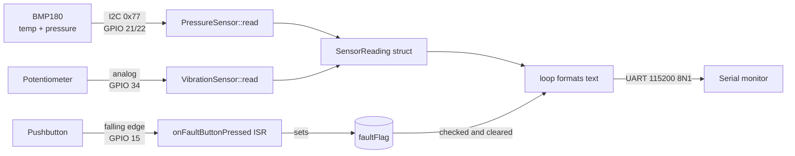

# downhole-telemetry-simulation

ESP32 firmware for a simulated downhole drilling sensor, run in the [Wokwi](https://wokwi.com) simulator. It reads temperature and pressure from a BMP180 sensor over I2C, reads a potentiometer as a stand-in for a vibration sensor, watches a pushbutton that injects a fault, and streams one line of readings per second over a UART serial connection. The goal is to model how a real measurement-while-drilling (MWD) tool samples its sensors downhole and sends data up to the surface.

> **Status:** early prototype. Sensor reading, fault input and serial output work today. Binary packet framing, separate RTOS tasks and automatic fault detection are planned and described in the [Roadmap](#roadmap).

## Table of contents

- [Why this project exists](#why-this-project-exists)
- [Hardware](#hardware)
- [Wiring](#wiring)
- [How the parts communicate](#how-the-parts-communicate)
- [Firmware walkthrough](#firmware-walkthrough)
- [Data flow](#data-flow)
- [Serial output](#serial-output)
- [Building and running](#building-and-running)
- [Project structure](#project-structure)
- [Known issues and limitations](#known-issues-and-limitations)
- [Roadmap](#roadmap)
- [Glossary](#glossary)

## Why this project exists

This is a portfolio project built to show embedded systems competency for SLB's digital technology internship. It models a downhole drilling telemetry device. "Tele" means distant and "metry" means measurement: the device measures conditions at the bottom of a well and reports them to people at the surface, including warnings when something goes wrong.

Things that can go wrong while drilling, and that a tool like this is meant to help catch, include:

| Problem | What a sensor would see |
| --- | --- |
| Overheating of electronics or the bit | Temperature climbing past a safe limit |
| A kick (formation fluid entering the well) | A sudden change in downhole pressure |
| Stick-slip, whirl or bit bounce | Strong or erratic vibration |
| A failed or disconnected sensor | No response from the sensor on its bus |

In this simulation, the BMP180 provides temperature and pressure, a potentiometer stands in for a vibration sensor (a piezoelectric sensor or 3-axis accelerometer in a real tool), and a pushbutton lets you inject a fault by hand.

## Hardware

All parts are defined in [`diagram.json`](diagram.json) and run inside Wokwi.

| Part | Wokwi type | Role in the project |
| --- | --- | --- |
| ESP32 DevKitC v4 | `board-esp32-devkit-c-v4` | Main microcontroller. Runs the firmware. |
| BMP180 | `board-bmp180` | Temperature and barometric pressure sensor, read over I2C. |
| Potentiometer | `wokwi-potentiometer` | Simulated vibration sensor. Turning it changes an analog voltage. |
| Pushbutton (green) | `wokwi-pushbutton` | Fault injection. Pressing it triggers an interrupt. |
| Mini breadboard | `wokwi-breadboard-mini` | Shares 3.3 V and ground between parts. |

## Wiring

| From | To (ESP32) | Signal type | Notes |
| --- | --- | --- | --- |
| BMP180 SDA | GPIO 21 | I2C data | Default I2C data pin on the ESP32 |
| BMP180 SCL | GPIO 22 | I2C clock | Default I2C clock pin on the ESP32 |
| Potentiometer SIG | GPIO 34 | Analog (ADC) | GPIO 34 is input-only, which suits an ADC read |
| Pushbutton | GPIO 15 | Digital input with interrupt | Other side of the button goes to ground |
| ESP32 TX / RX | Serial monitor RX / TX | UART | TX on one side always wires to RX on the other |
| BMP180, potentiometer VCC | 3V3 | Power | Shared through the breadboard |
| BMP180, potentiometer, button | GND | Ground | Shared through the breadboard |

```
                  I2C                              UART
+----------+                 +-----------+                   +----------------+
|  BMP180  |  SDA --- GPIO 21|   ESP32   |TX -------------> RX| Serial monitor |
|   0x77   |  SCL --- GPIO 22|           |RX <------------- TX|  115200 baud   |
+----------+                 +-----------+                   +----------------+
                              GPIO 34  GPIO 15
                                 |        |
                         Potentiometer  Pushbutton --- GND
                           (analog)     (falling-edge interrupt)
```

The pushbutton has no external resistor. The firmware turns on the ESP32's internal pull-up on GPIO 15, so the pin reads high when the button is released and drops to low when it is pressed.

## How the parts communicate

The project uses two serial communication protocols and two plain pin reads.

### I2C (sensor to ESP32)

I2C (Inter-Integrated Circuit) is a two-wire bus. **SDA** carries data and **SCL** carries a clock. The ESP32 is the *controller*: it drives the clock and starts every transaction. The BMP180 is a *target* with the fixed 7-bit address `0x77`.

Every conversation starts with the controller sending the target's address. The target with that address pulls SDA low for one clock to acknowledge (an *ACK*). Then the controller names the register it wants and reads the bytes back. Several devices can share the same two wires as long as each has a different address, so adding a second sensor (for example an MPU-6050 accelerometer at `0x68`) does not use any new pins.

The firmware never touches I2C directly. The [Adafruit BMP085 Unified](https://github.com/adafruit/Adafruit_BMP085_Unified) driver handles it through the Arduino `Wire` library, which on the ESP32 defaults to GPIO 21 and 22 at 100 kHz. The BMP085 driver also works with the BMP180, which is a register-compatible successor.

### UART (ESP32 to serial monitor)

UART (Universal Asynchronous Receiver-Transmitter) links exactly two devices with two crossed wires, TX to RX. It has no clock wire, so both ends agree on a speed ahead of time. This project uses **115200 baud** (bits per second) with the common **8N1** format: one start bit, 8 data bits sent lowest bit first, no parity bit and one stop bit. That works out to about 11,520 characters per second.

`Serial.begin(115200)` opens UART0. On a physical DevKit board, UART0 goes through a USB-to-serial chip to your computer. In Wokwi, `diagram.json` wires `esp:TX` and `esp:RX` straight to the built-in serial monitor.

### Analog input (potentiometer)

The potentiometer outputs a voltage between 0 and 3.3 V. The ESP32's ADC is set to 12-bit resolution, so `analogRead` returns a value from **0 to 4095**. The firmware stores this raw number as the vibration reading without converting it to physical units.

### Digital input with interrupt (pushbutton)

The button is attached to a hardware interrupt on the **falling edge** (the moment the pin goes from high to low). When that happens, the CPU pauses whatever it is doing and runs the interrupt service routine (ISR) right away, instead of waiting for the main loop to check the pin.

## Firmware walkthrough

All of the firmware is in [`src/main.cpp`](src/main.cpp).

### Configuration constants

```cpp
constexpr uint8_t  kVibrationAdcPin = 34;
constexpr uint8_t  kFaultButtonPin = 15;
constexpr uint32_t kFaultDebounceMs = 200;
```

Pin numbers and the debounce window are kept in one place so the wiring can change without hunting through the code.

### Fault interrupt: `onFaultButtonPressed()`

```cpp
volatile bool faultFlag = false;
volatile uint32_t lastFaultMillis = 0;

void IRAM_ATTR onFaultButtonPressed() { ... }
```

- `IRAM_ATTR` places the function in the ESP32's internal RAM so it can run even while flash memory is busy. ESP32 interrupt handlers should always be marked this way.
- A mechanical button "bounces" and can produce several edges per press. The ISR ignores any edge that arrives less than 200 ms after the last accepted one.
- The ISR does as little as possible: it only sets `faultFlag`. The main loop does the slow work (printing) later. Both variables are `volatile` because they are shared between the ISR and the main loop, and `volatile` stops the compiler from caching them in a register.

### `SensorReading` struct

| Field | Type | Units | Filled by |
| --- | --- | --- | --- |
| `temperatureCelsius` | `int32_t` | hundredths of a degree C (2450 = 24.50 °C) | `PressureSensor::read` |
| `pressurePascal` | `uint32_t` | pascals | `PressureSensor::read` |
| `timestampMilliseconds` | `uint32_t` | ms since boot | `PressureSensor::read` |
| `vibrationRaw` | `uint32_t` | raw ADC counts, 0 to 4095 | `loop()` from `VibrationSensor::read` |

Temperature is stored as a scaled integer instead of a `float`. Fixed-point integers are smaller, faster on microcontrollers without a strong floating-point unit, and pack cleanly into a binary telemetry frame later.

### `PressureSensor` class

Wraps the Adafruit `Adafruit_BMP085_Unified` driver so the rest of the code doesn't depend on the library directly.

- `begin()` starts I2C and checks that a BMP180 answers at `0x77`. It returns `false` if no sensor responds.
- `read(SensorReading& out)` fetches a pressure event and the temperature. The driver reports pressure in hectopascals, so the code multiplies by 100 to get pascals. Temperature is multiplied by 100 to store hundredths of a degree. It also stamps the reading with `millis()`. It returns `false` if the pressure came back as zero.

### `VibrationSensor` class

- `begin(uint8_t adcPin)` remembers the pin and sets the ADC to 12-bit resolution.
- `read()` returns the raw ADC value from 0 to 4095.

### `setup()`

1. Opens UART at 115200 baud and prints `[BOOT] downhole-telemetry-sim starting!`.
2. Calls `pressureSensor.begin()`. If the BMP180 does not respond, prints `[FATAL] Sensor initialization failed!` and halts in an endless loop instead of streaming bad data.
3. Sets up the vibration ADC on GPIO 34.
4. Sets GPIO 15 as an input with the internal pull-up enabled and attaches the fault interrupt on the falling edge.
5. Prints `[BOOT] Sensors are okay!`.

### `loop()`

Runs about once per second:

1. Creates an empty `SensorReading`.
2. Reads temperature and pressure over I2C and the vibration value from the ADC.
3. Prints a timestamp, then the temperature and pressure (or `[pressure read failed]`), then the vibration value.
4. If the fault flag is set, clears it and prints `[FAULT]`.
5. Waits 1000 ms with `delay()`.

## Data flow



The sensor path is *polled*: the loop asks for new values on a fixed schedule. The fault path is *interrupt-driven*: the button press is captured the instant it happens, even in the middle of the one-second `delay()`, and reported on the next pass through the loop.

## Serial output

On boot:

```
[BOOT] downhole-telemetry-sim starting!
[BOOT] Sensors are okay!
```

Then one line per second, in this format (the values below are examples):

```
t=1103ms temp=24.00C  pressure=101325Pa  vibration=2048
t=2108ms temp=24.00C  pressure=101325Pa  vibration=3110
```

After the button is pressed, the next line ends with `[FAULT]`:

```
t=3112ms temp=24.00C  pressure=101325Pa  vibration=3110[FAULT]
```

If the sensor was not found at startup, the output stops after:

```
[BOOT] downhole-telemetry-sim starting!
[FATAL] Sensor initialization failed!
```

## Building and running

### Requirements

- [Visual Studio Code](https://code.visualstudio.com/)
- The [PlatformIO IDE](https://platformio.org/install/ide?install=vscode) extension (recommended automatically by `.vscode/extensions.json`)
- The [Wokwi for VS Code](https://docs.wokwi.com/vscode/getting-started) extension, which needs a Wokwi license (a free community license is available)

PlatformIO downloads the ESP32 toolchain and the libraries listed in [`platformio.ini`](platformio.ini) the first time you build:

```ini
[env:esp32dev]
platform = espressif32
board = esp32dev
framework = arduino
monitor_speed = 115200
lib_deps =
    adafruit/Adafruit BMP085 Unified@^1.1.3
    adafruit/Adafruit Unified Sensor@^1.1.14
```

### Build

From the PlatformIO sidebar, choose **Build**, or from a terminal:

```bash
pio run
```

This produces `.pio/build/esp32dev/firmware.bin` and `firmware.elf`, which is where [`wokwi.toml`](wokwi.toml) tells Wokwi to look.

### Run in Wokwi

1. Build the firmware first. Wokwi runs the compiled binary, not the source code.
2. Open the command palette (`F1` or `Ctrl+Shift+P`) and run **Wokwi: Start Simulator**.
3. The serial monitor opens in the simulator panel and shows the boot messages and readings.
4. While it runs, you can:
   - turn the potentiometer to change the vibration value,
   - click the BMP180 to adjust its simulated temperature and pressure,
   - press the green button to inject a fault.

After changing the code, build again and restart the simulator to load the new firmware.

### Run on real hardware

The same firmware runs on a physical ESP32 DevKit wired as shown in [Wiring](#wiring). Upload and open the serial monitor with:

```bash
pio run --target upload
pio device monitor
```

The monitor uses 115200 baud from `monitor_speed` in `platformio.ini`.

## Project structure

```
.
├── src/
│   └── main.cpp            All firmware: pins, ISR, sensor classes, setup() and loop()
├── include/README          PlatformIO placeholder for project header files
├── lib/README              PlatformIO placeholder for private libraries
├── test/README             PlatformIO placeholder for unit tests
├── test.cpp                Copy of src/main.cpp (not built, see Known issues)
├── diagram.json            Wokwi circuit: parts and wiring
├── wokwi.toml              Tells Wokwi where the compiled firmware is
├── platformio.ini          Board, framework, serial speed and library dependencies
└── .vscode/extensions.json Recommends the PlatformIO extension
```

## Known issues and limitations

These describe the code as it is today, so readers know what to expect.

- **The pressure sensor is read twice per loop.** `loop()` calls `pressureSensor.read(reading)` once and stores the result in `pressureOk`, then calls it again inside an `if` whose success branch is empty. The second read only matters when it fails, in which case it prints `[WARNING] Pressure sensor read failed` on its own line. One read per loop is enough.
- **`test.cpp` is not a test.** It is an identical copy of `src/main.cpp` in the repository root. PlatformIO only builds files in `src/` and only runs tests from `test/`, so this file is ignored.
- **A fault adds a blank line.** `[FAULT]` is printed with `println`, and then the loop prints another newline, which leaves an empty line in the output after each fault.
- **`timestampMilliseconds` is set but not used.** The loop prints its own `millis()` call instead of the timestamp stored in the reading.
- **Faults are manual only.** There is no threshold checking yet. A fault is reported only when the button is pressed.
- **Vibration is a raw number.** The ADC value is not converted to physical units such as g or m/s².
- **Timing is approximate.** `delay(1000)` blocks the CPU, and the time spent reading sensors and printing adds to it, so lines arrive slightly more than one second apart.
- **Output is human-readable text.** Each line is around 55 characters. A real downhole link is far too slow for that; see packet framing below.
- The comment above `PressureSensor` says "BME180"; the part is a BMP180.

## Roadmap

### 1. Compact binary packet framing

A real MWD tool usually sends data to the surface by *mud-pulse telemetry*: pressure pulses through the drilling fluid, at only a few bits per second. Every bit counts, so readings are packed into small binary frames instead of text. A proposed frame:

| Field | Size | Purpose |
| --- | --- | --- |
| Sync word | 2 bytes | Fixed pattern (for example `0xAA 0x55`) so the receiver can find the start of a frame |
| Sequence number | 1 byte | Increments each frame, so the surface can detect lost frames |
| Timestamp | 4 bytes | `timestampMilliseconds` |
| Temperature | 2 bytes | Hundredths of a degree C, signed |
| Pressure | 4 bytes | Pascals |
| Vibration | 2 bytes | Raw ADC counts |
| Status flags | 1 byte | Bit 0 fault button, bit 1 sensor read failed, bits 2 to 4 threshold alarms |
| CRC-16 | 2 bytes | Detects frames corrupted in transit |

That is 18 bytes per reading, compared with about 55 bytes of text. A small decoder script on the receiving side would turn frames back into readable values.

### 2. FreeRTOS tasks

The ESP32 Arduino core already runs on FreeRTOS: `setup()` and `loop()` run inside a single FreeRTOS task. The plan is to split the work into separate tasks:

- a **sampling task** that reads the sensors on a fixed period using `vTaskDelayUntil`, so timing doesn't drift,
- a **telemetry task** that takes readings from a queue, builds frames and sends them over UART,
- a **fault handler** that the ISR wakes with a task notification instead of a shared flag.

This keeps sampling on time even when transmitting is slow, and it shows how real embedded firmware separates concerns.

### 3. Automatic fault detection

Add configurable thresholds that set alarm flags without a button press:

- temperature above a limit (overheating),
- a pressure change faster than a limit (possible kick),
- vibration above a limit, or rapid swings in vibration (stick-slip or bit bounce),
- the BMP180 failing to acknowledge on I2C during operation (sensor failure).

### 4. More sensors and tests

- Replace the potentiometer with a real 3-axis accelerometer, such as an MPU-6050 at I2C address `0x68` on the same bus.
- Add unit tests in `test/` with the PlatformIO Test Runner, starting with frame encoding and CRC calculation, which don't need hardware.
- Fix the items listed under [Known issues](#known-issues-and-limitations).

## Glossary

| Term | Meaning |
| --- | --- |
| ADC | Analog-to-digital converter. Turns a voltage into a number. |
| ACK / NACK | I2C acknowledgment. The receiver pulls SDA low (ACK) to confirm it received a byte, or leaves it high (NACK). |
| Baud | Bits per second on a UART line. |
| BMP180 | Bosch temperature and pressure sensor with an I2C interface. |
| Debounce | Ignoring the extra electrical edges a mechanical button produces when pressed. |
| I2C | Two-wire shared bus with a clock line and addressed devices. |
| ISR | Interrupt service routine. A function the CPU runs immediately when a hardware event happens. |
| MWD | Measurement while drilling. Sensors in the drill string that report conditions in real time. |
| Mud-pulse telemetry | Sending data to the surface as pressure pulses in the drilling fluid. |
| UART | Two-device serial link with no clock wire, using an agreed baud rate. |
| Wokwi | Online simulator that emulates the ESP32 and simulates the parts wired to it. |
