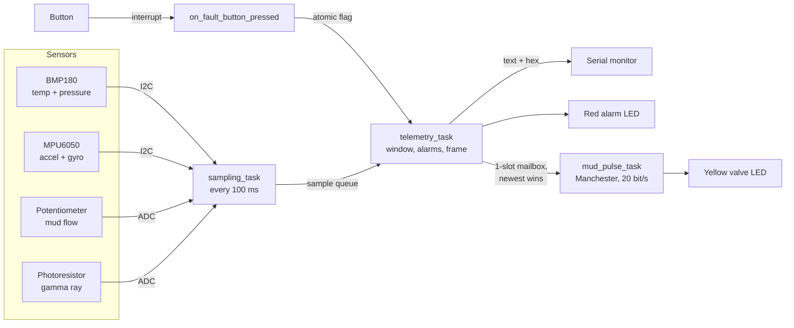

# downhole-telemetry-simulation

ESP32 firmware for a simulated downhole drilling tool, run in the [Wokwi](https://wokwi.com) simulator. It measures what a real measurement-while-drilling (MWD) tool measures at the bottom of a well (temperature, pressure, shock, jerk, how smoothly the bit spins, how much drilling mud is flowing, and what kind of rock the bit is in), packs it into small binary frames protected by a checksum, and "pulses" those frames to the surface the way a real mud-pulse tool does.

It is written to be readable by someone who knows software but is new to embedded systems. Every hardware idea is explained next to the code that uses it.

## Table of contents

- [The big picture](#the-big-picture)
- [What the tool measures and why](#what-the-tool-measures-and-why)
- [Getting data to the surface: mud-pulse telemetry](#getting-data-to-the-surface-mud-pulse-telemetry)
- [Hardware and wiring](#hardware-and-wiring)
- [Embedded ideas, explained for software people](#embedded-ideas-explained-for-software-people)
- [Firmware architecture](#firmware-architecture)
- [The telemetry frame](#the-telemetry-frame)
- [Alarms](#alarms)
- [Serial output](#serial-output)
- [Building, running and testing](#building-running-and-testing)
- [A five-minute demo](#a-five-minute-demo)
- [Limitations](#limitations)
- [Roadmap](#roadmap)
- [Glossary](#glossary)

## The big picture

When a well is drilled, a long string of steel pipe turns a drill bit thousands of meters underground. Just above the bit sits a pipe section stuffed with electronics: the downhole tool. Nobody can see down there, so this tool is the driller's eyes. It has three jobs:

1. **Protect the drilling.** Notice when the bit is being shaken apart, getting stuck, overheating, or when the well is about to let gas or fluid in (a "kick").
2. **Describe the rock.** Tell geologists what kind of rock the bit is in, so they can steer toward oil or gas.
3. **Report all of this to the surface while drilling continues,** over a communication channel that is extremely slow.

```
   surface rig  <-- pressure pulses travel up the mud -----+
        |                                                  |
        |  drill pipe (mud pumped down the inside)         |
        |                                                  |
   +-----------+                                           |
   |  THIS     |  sensors -> ESP32 -> frames -> pulser ----+
   |  PROJECT  |
   +-----------+
        |
    drill bit
```

This project simulates job 1 and part of job 2 with real sensor chips (or simple stand-ins) inside Wokwi, and simulates job 3 with a blinking LED that plays the role of the mud-pulse valve.

## What the tool measures and why

| Measurement | Why a downhole tool cares | Real tool uses | This project uses |
| --- | --- | --- | --- |
| Temperature | Electronics fail above about 150 to 175 °C. Rising heat also hints that the bit is rubbing. | Platinum resistance sensors | **BMP180** chip (I2C) |
| Pressure | A sudden jump or drop can mean a **kick**: gas or fluid from the rock entering the well. Kicks cause blowouts. | Quartz or strain-gauge pressure gauges | **BMP180** chip (I2C) |
| Shock | A single violent hit (for example the bit slamming into a hard rock layer) can crack circuit boards or break the bit. | Accelerometers | **MPU6050** accelerometer (I2C) |
| Jerk | Jerk is how fast acceleration *changes*. Smooth vibration has low jerk. Impacts and bit bounce have very high jerk, so jerk separates "rough but fine" from "being hammered". | Calculated from accelerometer data | Calculated from the MPU6050 |
| Rotation speed and stick-slip | **Stick-slip** is when friction makes the bit stop, the pipe above winds up like a spring, and then the bit whips around much faster than intended. It is one of the main causes of broken bits. | Gyroscopes or magnetometers | **MPU6050** gyroscope (I2C) |
| Mud flow | Drilling mud is pumped down the pipe and out through the bit. It **cools and lubricates** the bit, carries the rock cuttings up, and holds back pressure from the rock. Too little flow means a hot, badly lubricated bit and cuttings that pack around it. | Turbine flow meters | **Potentiometer** (analog) |
| Gamma ray | Shale rock is naturally a little radioactive, sand and limestone are not. Counting gamma rays tells the geologist which layer the bit is in. | A scintillator crystal that flashes when a gamma ray hits it, plus a light detector | **Photoresistor** (analog). Brighter light = more flashes = more gamma |
| Manual fault | Lets you inject a fault by hand to test the alarm path. | Not applicable | **Pushbutton** (interrupt) |

### What about "detecting a dense surface"?

Real logging tools measure rock *density* with a small radioactive source and two detectors, which is not something a simulator can offer. This project covers the same question ("did we just hit something hard or different?") with the signals a drilling engineer would actually watch:

- **Gamma ray** changes when the bit crosses from one rock layer into another.
- **Shock and jerk** spike when the bit hits a harder layer.
- **Stick-slip** gets worse in hard, sticky rock because friction goes up.

## Getting data to the surface: mud-pulse telemetry

There is no Wi-Fi or cable down a drilling well. The most common way to send data up is **mud-pulse telemetry**. A valve inside the tool briefly blocks the mud flow. That creates a pressure pulse that travels up the mud column to a pressure sensor at the rig, a few kilometers away. Open and close the valve in a pattern and you are sending bits, a bit like Morse code with pressure.

It is very slow: roughly **1 to 20 bits per second**. For comparison, the serial monitor in this project runs at 115,200 bits per second. That one fact shapes the whole design:

- **Binary, not text.** A line like `temp=24.00C pressure=101325Pa ...` costs about 150 bytes. The same data as a binary frame is 28 bytes.
- **Summaries, not raw samples.** The tool samples ten times a second but sends one summary (with the peaks) per frame.
- **Newest data wins.** Sending one frame takes about 12 seconds at 20 bits per second, while a new frame is ready every second. The pulser always sends the most recent frame and skips the ones in between. A real tool does the same thing and stores the full-rate data in memory to be downloaded when the tool comes back up.

### How bits become pulses (Manchester encoding)

The LED on GPIO 4 is the valve: **lit means closed, which means a pressure pulse.** Each bit is split into two halves and always flips in the middle:

```
 bit:      1        0        1        1
 halves:  low|HIGH HIGH|low low|HIGH low|HIGH
 LED:     off| on   on |off off| on  off| on
```

- A **1** is sent as low, then high.
- A **0** is sent as high, then low.

Because the signal always changes in the middle of a bit, the receiver can recover the timing from the signal itself, and a long run of zeros never looks like a broken line. Every frame starts with a short **preamble** of `10101010` patterns so the surface can lock onto the rhythm before the real data starts. This is the same idea used by classic 10 Mbit Ethernet.

Other real-world uplinks you may hear about in an interview: **EM telemetry** (low-frequency radio waves pushed through the rock, faster but limited in depth), and **wired drill pipe** (a cable built into every pipe joint, very fast and very expensive). The framing and CRC in this project would work unchanged over any of them; only the transmitter class would change.

## Hardware and wiring

All parts are defined in [`diagram.json`](diagram.json) and run inside Wokwi.

| Part | Wokwi type | Role |
| --- | --- | --- |
| ESP32 DevKitC v4 | `board-esp32-devkit-c-v4` | The microcontroller. Runs the firmware. |
| BMP180 | `board-bmp180` | Temperature and pressure, I2C address `0x77` |
| MPU6050 | `wokwi-mpu6050` | 3-axis accelerometer + 3-axis gyroscope, I2C address `0x68` |
| Potentiometer | `wokwi-potentiometer` | Mud flow rate, 0 to 1000 gallons per minute |
| Photoresistor module | `wokwi-photoresistor-sensor` | Gamma ray, 0 to 150 API units |
| Pushbutton (green) | `wokwi-pushbutton` | Manual fault |
| Yellow LED + 220 Ω resistor | `wokwi-led`, `wokwi-resistor` | Mud-pulse valve. Flickers while a frame is being sent. |
| Red LED + 220 Ω resistor | `wokwi-led`, `wokwi-resistor` | Alarm light. On while any alarm is raised. |
| Mini breadboard | `wokwi-breadboard-mini` | Shares 3.3 V and ground |

| From | ESP32 pin | Signal type |
| --- | --- | --- |
| BMP180 SDA, MPU6050 SDA | GPIO 21 | I2C data (shared bus) |
| BMP180 SCL, MPU6050 SCL | GPIO 22 | I2C clock (shared bus) |
| Potentiometer SIG | GPIO 34 | Analog input |
| Photoresistor AO | GPIO 35 | Analog input |
| Pushbutton | GPIO 15 | Digital input, falling-edge interrupt |
| Yellow LED (through resistor) | GPIO 4 | Digital output |
| Red LED (through resistor) | GPIO 5 | Digital output |
| Serial monitor | TX / RX | UART, 115200 baud |

```
                       I2C bus (2 wires, shared)
        +---------+  +---------+
        | BMP180  |  | MPU6050 |
        |  0x77   |  |  0x68   |
        +----+----+  +----+----+
             |            |
     SDA/SCL +-----+------+
                   |  GPIO 21 / 22
              +----+-----+   GPIO 4 ---[220R]---> yellow LED (mud pulser)
 pot -------->| GPIO 34  |   GPIO 5 ---[220R]---> red LED (alarm)
 photoresistor| GPIO 35  |
 button ----->| GPIO 15  |   TX/RX -------------> serial monitor
              |  ESP32   |
              +----------+
```

All pin numbers live in one file, [`include/config.h`](include/config.h). Rewiring never requires hunting through the code.

## Embedded ideas, explained for software people

### Pins, voltages and the ADC

A microcontroller talks to the outside world through metal pins. A **digital** pin is either low (0 V) or high (3.3 V on the ESP32), like a boolean. An **analog** pin measures a voltage anywhere in between. The **ADC** (analog-to-digital converter) turns that voltage into a number. This project uses 12-bit resolution, so 0 V reads as 0 and 3.3 V reads as 4095.

[`AnalogChannel`](include/sensors.h) turns that raw number into real units with a straight-line scale: `raw * full_scale / 4095`. The same class is used for both mud flow and gamma ray. The photoresistor's voltage *drops* as light increases, so its channel is created with `inverted = true`.

### I2C: one shared bus for many chips

I2C uses two wires: **SDA** (data) and **SCL** (clock). The ESP32 drives the clock and starts every conversation. Every chip on the bus has an **address**, like an IP address on a tiny network. The ESP32 sends the address first, and only the chip with that address answers (it "acknowledges", or ACKs).

That is why the BMP180 (`0x77`) and the MPU6050 (`0x68`) sit on the *same* two wires. Adding the MPU6050 did not cost a single extra pin. If a chip does not ACK at startup, the firmware reports it as missing and flags its data as failed in every frame, instead of crashing. A real tool keeps sending whatever still works.

### Interrupts: hardware callbacks

Polling a button means checking it in a loop and maybe missing a short press. An **interrupt** asks the hardware to call a function the instant the pin changes, no matter what else is running. That function is an **ISR** (interrupt service routine). Rules for ISRs, which the code follows:

- Keep it tiny. [`on_fault_button_pressed`](src/main.cpp) only records the time and sets a flag.
- Mark it `IRAM_ATTR` so the ESP32 keeps it in fast internal RAM.
- Share data with the rest of the program through `std::atomic` (or `volatile`) so the compiler never caches a stale copy.
- **Debounce.** A mechanical button "bounces" and produces several edges per press. Edges less than 200 ms apart are ignored.

### FreeRTOS: threads, channels and locks

The ESP32 runs **FreeRTOS**, a small real-time operating system. If you know threads, you already know most of it:

| FreeRTOS | Software equivalent | Used here for |
| --- | --- | --- |
| Task | Thread | Sampling, telemetry, mud pulsing |
| Queue | Thread-safe channel (like a Go channel) | Passing samples and frames between tasks |
| Mutex | Lock | Keeping printed lines from mixing together |
| `vTaskDelayUntil` | `sleep_until(next_deadline)` | Sampling exactly every 100 ms with no drift |
| Priority | Thread priority, but strict | The sampling task always runs first when it is ready |

"Real-time" means *on time*, not *fast*. Sensor sampling must happen every 100 ms even while the slow mud pulser is busy for 11 seconds. Giving each job its own task, and giving sampling the highest priority, guarantees that.

### Fixed-point numbers and byte order

Floating point is convenient, but a `float` is 4 bytes and its format can differ between systems. Telemetry stores numbers as **scaled integers**: 24.50 °C is stored as `2450` (hundredths of a degree), 2.24 g as `2240` milli-g. The receiver divides back. This is called fixed-point.

Multi-byte numbers are sent **big-endian** (most significant byte first). The value `0x0960` (2400) is sent as `09 60`. Both sides agree on this ahead of time, so the receiver's CPU type does not matter.

### CRC: catching corrupted frames

A **CRC** (cyclic redundancy check) is a 2-byte fingerprint of the frame. The tool computes it and appends it. The surface recomputes it from the bytes it received. If even one bit was flipped by noise in the mud, the two values almost certainly differ and the frame is thrown away. This project uses **CRC-16/CCITT-FALSE**, a common choice for radio and modem links. A unit test checks it against the standard reference value (`"123456789"` gives `0x29B1`).

## Firmware architecture



| File | Responsibility |
| --- | --- |
| [`src/main.cpp`](src/main.cpp) | Creates the objects, queues and tasks. Wires the pipeline together. |
| [`include/config.h`](include/config.h) | Every pin, timing value and alarm limit, in one place |
| [`include/sensors.h`](include/sensors.h), [`src/sensors.cpp`](src/sensors.cpp) | `PressureSensor`, `MotionSensor`, `AnalogChannel`. Each hides one driver. |
| [`include/mud_pulse_transmitter.h`](include/mud_pulse_transmitter.h), [`src/mud_pulse_transmitter.cpp`](src/mud_pulse_transmitter.cpp) | Manchester-encodes bytes onto the valve pin |
| [`include/serial_logger.h`](include/serial_logger.h), [`src/serial_logger.cpp`](src/serial_logger.cpp) | Mutex-protected `printf`-style logging |
| [`include/telemetry_report.h`](include/telemetry_report.h), [`src/telemetry_report.cpp`](src/telemetry_report.cpp) | Prints a frame as values, hex bytes and flag names |
| [`lib/downhole_core/src/drilling_data.h`](lib/downhole_core/src/drilling_data.h) | `SensorSample`, `WindowSummary` and the status flag bits |
| [`lib/downhole_core/src/drilling_window.cpp`](lib/downhole_core/src/drilling_window.cpp) | Turns 10 samples into one summary: peak shock, peak jerk, RPM, stick-slip |
| [`lib/downhole_core/src/alarm_evaluator.cpp`](lib/downhole_core/src/alarm_evaluator.cpp) | Compares a summary against `AlarmThresholds` and raises flags |
| [`lib/downhole_core/src/telemetry_frame.cpp`](lib/downhole_core/src/telemetry_frame.cpp) | Encodes and decodes the 28-byte frame |
| [`lib/downhole_core/src/crc16.cpp`](lib/downhole_core/src/crc16.cpp) | CRC-16/CCITT-FALSE |
| [`test/test_downhole_core/test_main.cpp`](test/test_downhole_core/test_main.cpp) | Unit tests for everything in `lib/downhole_core` |
| [`tools/decode_frame.py`](tools/decode_frame.py) | The "surface" side: decodes a hex frame and checks its CRC |

### Design choices worth mentioning

- **Hardware and logic are separated.** Everything in `lib/downhole_core` is plain C++ with no Arduino code, so it runs and is tested on a laptop. Only `src/` touches pins and drivers. (Single responsibility, and dependency inversion: the logic depends on plain structs, not on chips.)
- **Configuration is data.** Alarm limits are an `AlarmThresholds` struct passed to `AlarmEvaluator`, so a different well can use different limits without editing the evaluation code (open for extension, closed for modification).
- **One class for every analog input.** `AnalogChannel` handles any linearly scaled voltage. Adding a third analog sensor is one line in `main.cpp`. (Don't repeat yourself.)
- **No dynamic memory.** Every buffer has a fixed size known at compile time. Firmware that runs for weeks underground cannot risk heap fragmentation.
- **A dead sensor does not stop the tool.** Each sensor class reports failure instead of halting, and the failure travels to the surface as a flag.

### How the measurements are calculated

All of this happens in [`DrillingWindow`](lib/downhole_core/src/drilling_window.cpp), once per 10 samples.

- **Shock** = the largest acceleration magnitude seen, `sqrt(x² + y² + z²)`, in g. Sitting still reads 1 g, because gravity is always there.
- **Jerk** = `|acceleration now - acceleration before| / time between samples`, in g per second. The largest value in the window is kept.
- **Rotation** = the gyroscope's z axis (along the drill string), converted from radians per second to RPM.
- **Stick-slip severity** = `(max RPM - min RPM) / (2 × average RPM)`, as a percentage. This is the formula the industry uses. 0% is a perfectly smooth spin. 100% means the bit is coming to a full stop and then spinning at twice the average speed. It is only computed while the bit is turning (average above 5 RPM).

## The telemetry frame

28 bytes, every multi-byte field big-endian:

| Offset | Size | Field | Units |
| --- | --- | --- | --- |
| 0 | 2 | Sync word `AA 55` | Marks the start of a frame |
| 2 | 1 | Sequence number | Counts up, wraps at 255. Gaps reveal lost frames. |
| 3 | 4 | Timestamp | ms since boot |
| 7 | 2 | Temperature (signed) | hundredths of °C |
| 9 | 4 | Pressure | Pa |
| 13 | 2 | Peak shock | milli-g |
| 15 | 2 | Peak jerk | milli-g per second |
| 17 | 2 | Average rotation (signed) | RPM |
| 19 | 1 | Stick-slip severity | % |
| 20 | 2 | Mud flow | gallons per minute |
| 22 | 2 | Gamma ray | API units |
| 24 | 2 | Status flags | One bit per condition, see [Alarms](#alarms) |
| 26 | 2 | CRC-16 | Of bytes 0 to 25 |

With the 2-byte preamble, each frame is 30 bytes = 240 bits, which takes 12 seconds at 20 bits per second.

## Alarms

| Bit | Flag | Raised when | How to trigger it in Wokwi |
| --- | --- | --- | --- |
| 0 | `MANUAL_FAULT` | The button was pressed since the last frame | Press the green button |
| 1 | `PRESSURE_SENSOR_FAILED` | The BMP180 did not answer | Delete the BMP180 from the diagram |
| 2 | `MOTION_SENSOR_FAILED` | The MPU6050 did not answer | Delete the MPU6050 from the diagram |
| 3 | `OVER_TEMPERATURE` | Temperature above 60 °C | Click the BMP180, raise temperature |
| 4 | `PRESSURE_KICK` | Pressure changed more than 20 hPa since the previous frame | Click the BMP180, drag pressure quickly |
| 5 | `HIGH_SHOCK` | Peak acceleration above 2 g | Click the MPU6050, push an acceleration axis toward its limit |
| 6 | `HIGH_JERK` | Acceleration changed faster than 5 g/s | Move an acceleration slider quickly |
| 7 | `STICK_SLIP` | Severity above 50% while rotating | Set gyro z, then swing it back and forth |
| 8 | `LOW_MUD_FLOW` | Mud flow below 200 gallons per minute | Turn the potentiometer down |
| 9 | `SHALE_FORMATION` | Gamma ray above 75 API | Click the photoresistor, raise the light level |

Bits 0 to 8 light the red LED. Bit 9 does not, because entering shale is information for the geologist, not a problem. The limits are set to what Wokwi's sliders can reach, not to real downhole values, and they are all in [`include/config.h`](include/config.h).

## Serial output

The values below are examples.

```
[BOOT] downhole-telemetry-sim starting
[BOOT] BMP180 pressure/temperature (I2C 0x77) OK
[BOOT] MPU6050 accelerometer/gyroscope (I2C 0x68) OK
[BOOT] tasks running
[FRAME   0] t=1003ms T=24.00C P=101325Pa shock=1.00g jerk=0.0g/s rpm=0 slip=0% flow=500gpm gamma=40API flags=0x0000
[HEX] AA 55 00 00 00 03 EB 09 60 00 01 8B CD 03 E8 00 00 00 00 00 01 F4 00 28 00 00 4C 73
[UPLINK] pulsing frame 0 to surface: 240 bits at 20 bit/s
[FRAME   1] t=2003ms ...
...
[FRAME  12] t=13003ms T=24.00C P=101325Pa shock=2.24g jerk=9.8g/s rpm=-12 slip=63% flow=150gpm gamma=96API flags=0x03E0
[HEX] AA 55 0C ...
[FLAGS] HIGH_SHOCK HIGH_JERK STICK_SLIP LOW_MUD_FLOW SHALE_FORMATION
[UPLINK] frame 0 delivered in 12000 ms
[UPLINK] pulsing frame 12 to surface: 240 bits at 20 bit/s
```

- `[FRAME]` is the decoded content, for people.
- `[HEX]` is exactly what goes up the mud, byte by byte.
- `[FLAGS]` names any raised status bits.
- `[UPLINK]` shows the slow pulser at work. Notice it jumps from frame 0 to frame 12: frames 1 to 11 were replaced by newer data before the pulser was free.

## Building, running and testing

### Requirements

- [Visual Studio Code](https://code.visualstudio.com/)
- The [PlatformIO IDE](https://platformio.org/install/ide?install=vscode) extension
- The [Wokwi for VS Code](https://docs.wokwi.com/vscode/getting-started) extension (a free community license is available)

PlatformIO downloads the ESP32 toolchain and the libraries in [`platformio.ini`](platformio.ini) on the first build: Adafruit BMP085 Unified, Adafruit Unified Sensor and Adafruit MPU6050.

### Build the firmware

```bash
pio run
```

This produces `.pio/build/esp32dev/firmware.bin` and `firmware.elf`, which is where [`wokwi.toml`](wokwi.toml) tells Wokwi to look.

### Run in Wokwi

1. Build first. Wokwi runs the compiled binary, not the source.
2. Press `F1` and run **Wokwi: Start Simulator**.
3. Click any sensor while the simulation runs to change its values.

### Run the unit tests (no hardware needed)

```bash
pio test -e native
```

This compiles `lib/downhole_core` for your computer and runs 10 tests: the CRC reference value, frame round-trip, corrupted-frame rejection, buffer-size safety, shock and jerk math, stick-slip math, sensor failure flags and the alarm rules. The native compiler needs `gcc`/`g++` installed (on Windows, use MinGW or WSL).

### Decode a frame like the surface would

Copy any `[HEX]` line from the serial monitor:

```bash
python tools/decode_frame.py "AA 55 0C 00 00 2F 02 09 60 00 01 8B CD 08 C0 26 48 FF F4 3F 00 96 00 60 03 E0 DF 15"
```

```
sequence      12
time          12034 ms
temperature   24.00 C
pressure      101325 Pa
peak shock    2.24 g
peak jerk     9.8 g/s
rotation      -12 RPM
stick-slip    63 %
mud flow      150 gal/min
gamma ray     96 API
flags         0x03E0 HIGH_SHOCK HIGH_JERK STICK_SLIP LOW_MUD_FLOW SHALE_FORMATION
CRC           OK
```

Change any single hex digit and run it again: the decoder reports a CRC mismatch.

## A five-minute demo

1. Start the simulator. Point out the boot lines: both I2C chips found at their addresses on the same two wires.
2. Watch the yellow LED flicker. That is a frame being pulsed to the surface at 20 bits per second. Point out `[UPLINK]` skipping frames because the channel is so slow.
3. Turn the potentiometer down: `LOW_MUD_FLOW`, red LED on. Explain why the bit needs mud.
4. Click the MPU6050 and move an acceleration slider fast: `HIGH_SHOCK` and `HIGH_JERK`. Explain the difference between the two.
5. Set gyro z and swing it: `STICK_SLIP`. Explain the wind-up and whip.
6. Raise the photoresistor's light: `SHALE_FORMATION`, red LED stays off. Explain gamma ray logging.
7. Press the button mid-transmission: the fault shows up in the next frame. That is the interrupt.
8. Copy a `[HEX]` line into `tools/decode_frame.py`, then flip one digit to show the CRC catching it.

## Limitations

- **Stand-ins are not real physics.** The potentiometer and photoresistor produce a straight-line scale. The photoresistor's response is not truly linear, so the gamma value is approximate across the slider.
- **Limits are scaled to the simulator.** Real tools run at 150 °C and above and at pressures hundreds of times higher than the BMP180 can measure.
- **Shock includes gravity.** Shock is the total acceleration, so a still tool reads 1 g. Real tools often report lateral and axial shock separately.
- **No receiver for the pulses.** The yellow LED is the transmitter only. Decoding is shown with the Python tool reading the hex line instead.
- **Frames are not stored.** A real tool keeps every frame in flash memory for download at the surface. Skipped frames are simply lost here.

## Roadmap

- A surface receiver task that reads the valve pin through a jumper wire, decodes the Manchester bits and checks the CRC, closing the loop inside the simulator.
- Store every frame in flash (for example with LittleFS) and add a "download memory" command.
- Downlink: let the surface change alarm limits or the bit rate by sending commands back down.
- Separate axial and lateral shock, and add a vibration level (RMS) next to the peaks.
- Forward error correction (for example Hamming codes) so a single flipped bit can be repaired instead of the whole frame being thrown away.

## Glossary

| Term | Meaning |
| --- | --- |
| ACK | I2C acknowledgment. A chip pulls the data line low to say "I heard you". |
| ADC | Analog-to-digital converter. Turns a voltage into a number. |
| API units | The standard unit for gamma ray logs. Clean sand reads about 15 to 30, shale 75 to 150. |
| Baud | Bits per second on a serial line. |
| Big-endian | Sending the most significant byte of a number first. |
| CRC | Cyclic redundancy check. A short fingerprint that detects corrupted data. |
| Debounce | Ignoring the extra edges a mechanical button makes when pressed. |
| FreeRTOS | A small real-time operating system with tasks, queues and mutexes. |
| g | Acceleration in multiples of Earth's gravity. 1 g = 9.81 m/s². |
| Gamma ray log | A record of natural radioactivity versus depth, used to tell rock types apart. |
| I2C | Two-wire shared bus where every chip has an address. |
| ISR | Interrupt service routine. A function the hardware calls the instant an event happens. |
| Jerk | How fast acceleration changes. High jerk means an impact. |
| Kick | Gas or fluid from the rock entering the well. Detected as a pressure change. |
| Manchester encoding | Sending each bit as two halves with a change in the middle, so timing travels with the data. |
| MWD | Measurement while drilling. Sensors in the drill string that report in real time. |
| Mud | Drilling fluid. Cools and lubricates the bit, carries cuttings up and holds back rock pressure. |
| Mud-pulse telemetry | Sending data to the surface as pressure pulses in the mud. |
| Preamble | A known pattern sent before data so the receiver can lock onto the timing. |
| RPM | Revolutions per minute. |
| Scintillator | A crystal that gives off a flash of light when a gamma ray hits it. |
| Stick-slip | The bit repeatedly stopping and then whipping around because of friction. |
| UART | Two-wire serial link between exactly two devices, with no clock wire. |
| Wokwi | Online simulator for the ESP32 and the parts wired to it. |
